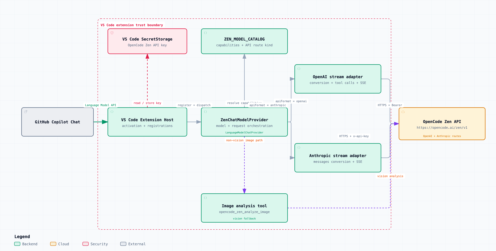

# OpenCode Zen Provider

VS Code extension project for using OpenCode Zen models in Copilot Chat with your own OpenCode Zen API key.

## Requirements

- VS Code 1.104.0 or later
- GitHub Copilot extension installed and active
- An OpenCode Zen API key from <https://opencode.ai/auth>

## Installation

### From Source

1. Clone this repository.
2. Run `bun install --ignore-scripts && bun run compile`.
3. Press `F5` in VS Code to launch the Extension Development Host.

### From VSIX

1. Run `bun install --ignore-scripts && bun run package:vsix`.
2. Install the generated `.vsix` file via **Install from VSIX...** in the Extensions view.

## Setup

1. Open Copilot Chat and open the model picker.
2. Add or configure **OpenCode Zen**.
3. Enter your OpenCode Zen API key when prompted.
4. If needed, run `OpenCode Zen: Manage OpenCode Zen API Key` from the Command Palette.
5. Select **OpenCode Zen** in Copilot Chat and choose a model.

## Supported Models

The extension bundles a static `ZEN_MODEL_CATALOG` (in `src/model-catalog.ts`) that mirrors the
current OpenCode Zen API lineup — every id `GET https://opencode.ai/zen/v1/models` serves, about
80 models. The main families:

- Anthropic: Claude Fable 5, Haiku 4.5 / 5.5, Opus 4.5–5.5, Sonnet 4.5–5.5
- DeepSeek: V4 Pro, V4 Flash, V4.1 Flash
- Gemini: 3 / 3.5 / 3.6 / 3.7 / 3.8 Flash, 3.x Pro, 4 Argon
- GPT: 5 / 5.1 / 5.2 / 5.3 Codex / 5.4 / 5.5 / 5.6 series
- GLM: 5, 5.1, 5.2, 5.3
- Grok: Build 0.1, 4.5, 4.6, 4.7
- Kimi: K2.5, K2.6, K2.7 Code, K3
- MiniMax: M2.5, M2.7, M3, M3.1
- Qwen: 3.5 / 3.6 Plus, 3.8 Flash / Max
- Others: Muse Spark / Wonder, LongCat, Nemotron, Flint
- Free tier: Big Pickle, `beam-free`, `flint-40b-free`, `glm-5.3-flash-free`, `longcat-2.5-preview-free`, `minimax-m3.1-flash-free`, `nemotron-3.5-lightning-free`, and more

For the full table of capabilities (context window, vision, tools, thinking, API format), see [docs/models.md](docs/models.md). The catalog and that table are generated — run `bun run sync:pi:write` to re-mirror them from the Zen API.

## Architecture

[](docs/architecture.html)

- [Open the interactive architecture diagram](docs/architecture.html) — Request path, key storage, model routing, and image-analysis fallback

## Documentation

- [Supported Models](docs/models.md) — Full model list, capabilities, context window, and model quirks

## Current V1 Scope

- Provider registration, API key management, static model catalog, and core chat-provider wiring are included.
- The custom image-analysis tool is available via `opencode_zen_analyze_image` and automatic image fallback for non-vision models.
- Non-vision models either switch to a vision-capable fallback model or delegate to the image-analysis tool when images are attached.

## Development

```bash
bun install --ignore-scripts
bun run compile
bun run lint
bun run test -- --runInBand
```

Press `F5` in VS Code to launch the Extension Development Host.

### Available Scripts

- `bun run compile` - TypeScript compile
- `bun run watch` - TypeScript watch mode
- `bun run test` - Run Jest
- `bun run lint` - Run ESLint
- `bun run lint:fix` - Auto-fix ESLint issues
- `bun run format` - Run Prettier
- `bun run package:vsix` - Build a VSIX package

## Marketplace Packaging

Build the VSIX package:

```bash
bun run package:vsix
```

Publishing is automated by [`.github/workflows/publish.yml`](.github/workflows/publish.yml): pushing a `v*` tag publishes the VSIX to the **VS Code Marketplace** (repository secret `VSCE_PAT`). This extension only registers a **GitHub Copilot Chat** model provider (`languageModelChatProviders`), and Copilot Chat does not exist in the editors Open VSX serves, so it is not published there.

To publish a VSIX manually:

```bash
vsce publish --packagePath opencode-zen-provider-<version>.vsix --allow-missing-repository   # VSCE_PAT
```

## Privacy

- Your API key is stored securely in VS Code SecretStorage.
- The Zen provider base URL is `https://opencode.ai/zen/v1`.
